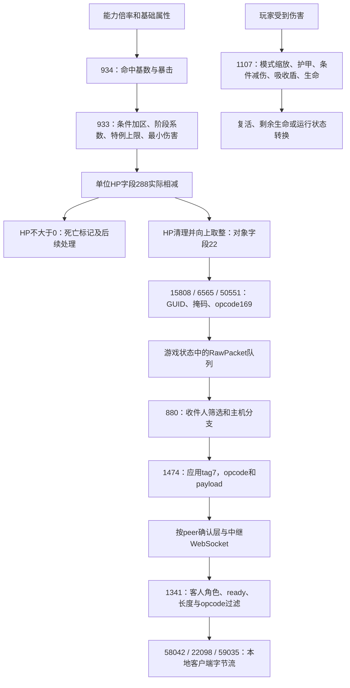

# 当前核心还原图

目标固定为 **Web 0.126.0 / 3e72472a**，不是旧 Windows 0.102.3。原始核心身份见 [targets.json](targets.json)。本页是当前静态研究的入口；完整指令、字节范围和哈希保存在本机证据中。

## 已接通的伤害与同步路径



图中的跨端路径来自发送、接收实现的静态对应，未以两台设备实测送达。另外已分别定位opcode169解析器、字段22读取和 `on_object_values` 对象字段更新系统；解析消息到该ECS系统的事件投递尚未闭合，不能将两端拼成完整运行证明。

## 已经能够解释什么

| 范围 | 已还原的具体内容 | 当前边界 |
|---|---|---|
| 一条技能命中路径 | 基础伤害、能力倍率、生命属性项、类别表、随机数及严格暴击比较 | 不是所有技能共用一条公式；float32顺序要保留。 |
| 敌人实际受伤 | 条件加成的加法累积、阶段倍率、特例上限、NaN处理、至少1点伤害、真实HP写回 | 反伤、触发效果和三处递归伤害尚未完整命名。 |
| 伤害统计和死亡 | 统计截在扣血前非负生命以内；原始HP可变负；HP≤0后设置死亡状态 | 原始扣血量、统计量、UI显示值不是同一数值。 |
| 玩家受伤 | 模式缩放、护甲、附近条件减伤、吸收盾、剩余生命及部分复活路径 | 保护标志和特定天赋的全部语义尚未恢复。 |
| HP结果同步 | 实际HP→字段22→opcode169→主机发送队列→应用tag7→客人过滤→客户端字节流 | 这条结果路径不能代表全部玩法的计算归属或完整联机兼容。 |
| 客户端对象侧 | 169→878→4642/9772的解析分支；命名系统→回调→字段合并/setter；字段22读取 | 解码消息到该系统的事件投递仍缺同一路径证据；未验证渲染/生命条收敛。 |
| 协议转写 | 两个不同标签空间；8/11个中继变体、19/25个应用变体的离线编解码 | 复杂未还原变体明确拒绝；远端服务实现不可由客户端直接恢复。 |
| 对象更新读取 | kind0值更新、packedGUID、字段掩码及u32字段；可读取字段22的HP | 只支持已观察子集，未实现创建、移动、压缩等变体。 |

具体公式、偏移、分支与依据见[伤害报告](reports/2026-11-01-damage-core.md)和[联机报告](reports/2026-11-01-coop-sync.md)。这已达到局部算法、状态转换和消息格式可读还原的程度，尚未恢复完整Rust源码、所有类型、ECS调度、全部技能规则或可替代原作的完整核心。

## 复现入口

```sh
# 复用已验证的完整WAT producer，建立只读查询用索引。
python3 reverse-engineering/scripts/wasm_index.py --producer /path/to/full-wat-producer

# 绑定原始核心和完整WAT身份，保留完整函数及关键指令位置。
python3 reverse-engineering/scripts/trace_damage.py --index /path/to/index.sqlite
python3 reverse-engineering/scripts/trace_coop.py --index /path/to/index.sqlite
python3 reverse-engineering/scripts/trace_client_values.py --index /path/to/index.sqlite

# 用独立手写字节样本核对本地协议转写，不连接或重放到游戏服务。
python3 reverse-engineering/scripts/check_coop_wire.py
python3 reverse-engineering/scripts/check_update_object_wire.py
```

`wasm_focus.py` 可显式指定 `--functions` 和 `--call-targets`，生成完整函数范围和真实REA库校验的本地Evidence。原版REA的8MiB输入限制保持不变；这里的流式扩展有独立提供方名称。`wasm_index.py` 同时记录 `call`、`return_call` 和WAT末行带右括号的指令，避免遗漏薄封装的尾部调用；间接调用需用实际vtable与元素表另外对应。

本轮代码仅用于研究，没有更改游戏核心、安装包或用户存档。模型、贴图与特效替换仍在另一条未完成的研究线上。

离线转写已通过27个合作协议样本和10个对象更新样本；509个截断、尾随或未覆盖输入被拒绝。样本是按原始指令独立手写的字节，不是线上抓包，也不是原游戏运行验收。
