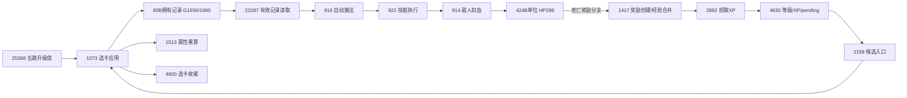
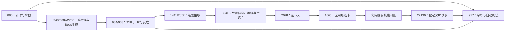
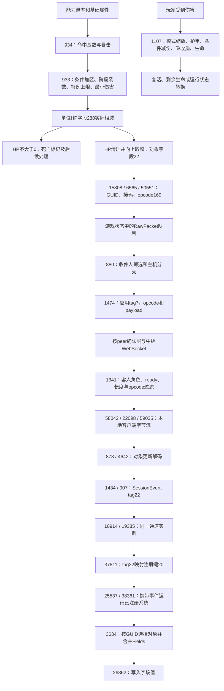

# 当前核心还原图

**主目标已切到官方0.134.0，Web build983346a7。** 本页分别列出新版主干与**历史Web0.126.0 / 3e72472a**依据；历史部分的编号和字段不能套到新版。新版Windows身份、函数与迁移见[版本策略](VERSION_STRATEGY.md)和[新版原生报告](reports/2026-11-01-latest-native-focused.md)。全模块最新状态与独立重造验收见[RECONSTRUCTION.md](RECONSTRUCTION.md)。

## 当前0.134.0已重新定位的技能主干



这是新版原指令的静态数据流，不是已可玩的独立闭环。新版[升级值11560例](reports/2026-11-01-upgrade0134-spec.md)、[完整1073的779例](reports/2026-11-01-selection0134-spec.md)、[完整914的454例](reports/2026-11-01-combat0134-spec.md)对照通过；其余箭头未因此自动获得执行验收。实际状态字段、调用点和新版新增伤害T加区见[选卡状态链](reports/2026-11-01-selection0134-chain.md)与[伤害链](reports/2026-11-01-combat0134-chain.md)。

新版[完整4630另完成2197例经验四字段对照](reports/2026-11-01-progression0134-spec.md)，确认120级上限。该phase3运行域没有执行2159；2862拾取、候选生成和死亡到XP的完整时序仍待独立实现与连接。

玩家受伤另由新1063处理，[139例非致死字段对照](reports/2026-11-01-incoming0134-spec.md)通过。独立实现仍是显式pending的标量前缀；盾耗尽、复活/死亡、完整IceBarrier施法与事件侧效未完成。

[完整1417/2862的345例基线](reports/2026-11-01-pickups0134-spec.md)后，现已扩展为[382例拾取与367例普通死亡组合对照](reports/2026-11-01-ordinary-pipeline0134.md)，均0差异。首次吸取与到期到账分开，45闲置上限会合并；普通flag0金币成功/失败的RNG已接入组合。其他奖励分支、属性/候选副作用和完整主循环仍未恢复到可玩层级。

## 历史0.126.0一局游戏的核心主干



箭头表示已定位的静态消费者主干，包含相应阶段、模式和状态guard；不是所有系统在每帧无条件执行。尤其多人全局/个人阶段、暂停/选卡及结束处理不能按简化图替代原顺序。

| 部分 | 当前结果 | 依据/边界 |
|---|---|---|
| 主循环 | 时差夹到0..0.1再转f32、阶段0..5、暂停门槛、多人状态交换及单人运行尾部调用顺序 | [主循环报告](reports/2026-11-01-game-loop.md)；尚无独立调度器或完整命令覆盖。 |
| 职业与技能 | 9职业、113定义，真实选卡写入→拥有技能读取→一条圆形施法 | [能力报告](reports/2026-11-01-abilities.md)；完整效果/触发尚缺。 |
| 世界与成长 | 12图、148普通/精英定义、60Boss定义，刷怪预算/权重、生成HP/攻击及经验升级 | [世界报告](reports/2026-11-01-world-progression.md)；完整AI/全部波次及RNG等尚缺。 |
| 独立数值 | 升级11560、成长24636、半径helper/组合29041份对照均0差异 | [升级](reports/2026-11-01-executable-spec.md)、[成长](reports/2026-11-01-world-progression.md)、[半径](reports/2026-11-01-radius-spec.md)；局部隔离函数验证，未执行原934外层或完整游戏。 |
| 账号存档 | 368B聚合、24正常tag及unlock兼容、一条地图解锁保存/加载链、RSE1结构 | [存档报告](reports/2026-11-01-save-schema.md)；仅静态及合成模型自检，尚无原件差分。 |
| 更易阅读的指令 | 1065已生成命名callee的合成模块C | [C阅读辅助](reports/2026-11-01-readable-ir.md)；不含callee实现/原数据初始化，不是源码恢复或独立实现。 |
| 随机数与经验 | 四字状态/高23位区间采样及拒绝重抽；85387舍入、XP阈值/循环/开卡guard投影 | [RNG](reports/2026-11-01-rng.md)18144组原体对照；[经验](reports/2026-11-01-progression.md)24643份原helper及5482份重组，均0差异；seed与完整副作用尚缺。 |
| 其他技能执行 | 12kind/14tag全目录和跳表入口；Fireball→112B待命中→到期→933 | [执行类别报告](reports/2026-11-01-cast-dispatch.md)；延迟到达不等于已恢复逐帧投射物碰撞/显示。 |
| 属性重算 | 4套modifier tag表、9职业/8种族、生命/暴击溢出/haste/护甲等真实写入 | [属性报告](reports/2026-11-01-derived-stats.md)；22个范围内store不等于完整属性模型已实现。 |

后续历史模型已进一步验证：原1573与原内部callee8495份、完整原1065有限5份、完整原933有限32份；见[属性模型](reports/2026-11-01-stats-spec.md)、[选卡状态](reports/2026-11-01-card-apply.md)、[战斗投影](reports/2026-11-01-combat-spec.md)。这些是受控合成状态的原件对照，不是新版或完整游戏验收。

## 已接通的伤害与同步路径



图中的跨端路径来自发送、接收实现的静态对应，未以两台设备实测送达。此前缺失的“解码消息→ECS对象更新系统”投递现已通过同一通道来源、注册键映射和已注册系统回调闭合，详见[事件投递报告](reports/2026-11-01-ecs-delivery.md)。这完成了该HP/对象字段值路径的静态还原，未替代真实运行验收。

## 已经能够解释什么

| 范围 | 已还原的具体内容 | 当前边界 |
|---|---|---|
| 一条技能命中路径 | 基础伤害、能力倍率、生命属性项、类别表、随机数及严格暴击比较 | 不是所有技能共用一条公式；float32顺序要保留。 |
| 敌人实际受伤 | 条件加成的加法累积、阶段倍率、特例上限、NaN处理、至少1点伤害、真实HP写回 | 反伤、触发效果和三处递归伤害尚未完整命名。 |
| 伤害统计和死亡 | 统计截在扣血前非负生命以内；原始HP可变负；HP≤0后设置死亡状态 | 原始扣血量、统计量、UI显示值不是同一数值。 |
| 玩家受伤 | 模式缩放、护甲、附近条件减伤、吸收盾、剩余生命及部分复活路径 | 保护标志和特定天赋的全部语义尚未恢复。 |
| HP结果同步 | 实际HP→字段22→opcode169→主机发送队列→应用tag7→客人过滤→事件投递→客户端字段写入 | 这条静态结果路径不能代表全部玩法的计算归属、真实送达或完整联机兼容。 |
| 客户端对象侧 | 解码→SessionEvent→同一通道→注册键20→系统回调→按GUID合并Fields；字段22读取 | 对象存在/实体及查询条件需成立；未验证渲染/生命条收敛。 |
| 协议转写 | 两个不同标签空间；8/11个中继变体、19/25个应用变体的离线编解码 | 复杂未还原变体明确拒绝；远端服务实现不可由客户端直接恢复。 |
| 对象更新读取 | kind0值更新、packedGUID、字段掩码及u32字段；可读取字段22的HP | 只支持已观察子集，未实现创建、移动、压缩等变体。 |

具体公式、偏移、分支与依据见[伤害报告](reports/2026-11-01-damage-core.md)、[联机报告](reports/2026-11-01-coop-sync.md)和[事件投递报告](reports/2026-11-01-ecs-delivery.md)。这已达到局部算法、状态转换、消息格式及该投递路径可读还原的程度，尚未恢复完整Rust源码、所有类型、完整ECS调度、全部技能规则或可替代原作的完整核心。

## 复现入口

```sh
# 复用已验证的完整WAT producer，建立只读查询用索引。
python3 reverse-engineering/scripts/wasm_index.py --producer /path/to/full-wat-producer

# 绑定原始核心和完整WAT身份，保留完整函数及关键指令位置。
python3 reverse-engineering/scripts/trace_damage.py --index /path/to/index.sqlite
python3 reverse-engineering/scripts/trace_coop.py --index /path/to/index.sqlite
python3 reverse-engineering/scripts/trace_client_values.py --index /path/to/index.sqlite
python3 reverse-engineering/scripts/trace_ecs_forward.py --index /path/to/index.sqlite
python3 reverse-engineering/scripts/trace_ecs_backward.py --index /path/to/index.sqlite
python3 reverse-engineering/scripts/ecs_event_map.py --index /path/to/index.sqlite
python3 reverse-engineering/scripts/trace_game_loop.py --index /path/to/index.sqlite
python3 reverse-engineering/scripts/trace_abilities.py --index /path/to/index.sqlite
python3 reverse-engineering/scripts/trace_world_progression.py --index /path/to/index.sqlite
python3 reverse-engineering/scripts/trace_save_schema.py --index /path/to/index.sqlite
python3 reverse-engineering/scripts/trace_cast_dispatch.py --index /path/to/index.sqlite
python3 reverse-engineering/scripts/trace_derived_stats.py --index /path/to/index.sqlite

# 用独立手写字节样本核对本地协议转写，不连接或重放到游戏服务。
python3 reverse-engineering/scripts/check_coop_wire.py
python3 reverse-engineering/scripts/check_update_object_wire.py
```

`wasm_focus.py` 可显式指定 `--functions` 和 `--call-targets`，生成完整函数范围和真实REA库校验的本地Evidence。原版REA的8MiB输入限制保持不变；这里的流式扩展有独立提供方名称。`wasm_index.py` 同时记录 `call`、`return_call` 和WAT末行带右括号的指令，避免遗漏薄封装的尾部调用；间接调用需用实际vtable与元素表另外对应。

以上代码仅用于研究，没有更改游戏核心、安装包或用户存档。独立规格位于[reconstruction/](reconstruction/README.md)，生产逻辑不读取或调用原核心；测试器执行隔离原件函数的范围在对应报告单列。模型、贴图与特效管线仍未完成。

离线转写已通过27个合作协议样本和10个对象更新样本；509个截断、尾随或未覆盖输入被拒绝。样本是按原始指令独立手写的字节，不是线上抓包，也不是原游戏运行验收。

后续投递调查另保留33个完整函数的REA Evidence，47处指令guard和5处结构化分支匹配通过；注册表恢复了25项命名网络系统。以上计数属于静态证据检查，不是对局测试数量。
