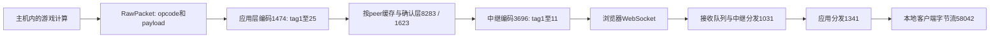

# 当前版合作同步：二进制协议、主机分支与 HP 结果通路

日期：2026-11-01（Asia/Taipei）。目标仅为 **0.126.0 / 3e72472a**，原始 WASM SHA-256 `067059375d884186338e6f86364b658f1daf6bdb779908d6d0c116f2068b147c`。以下是原件解码指令与局部数据流恢复，没有连接官方服务器、创建房间、发送协议帧或执行游戏。

## 本轮已到达的程度

本轮最初将一次HP更新追到：**实际扣血 → 对象字段22 → opcode169 → 主机远端队列 → 应用层帧 → 客人过滤 → 本地客户端字节流**。后续又补齐解码消息到注册系统及对象字段写入，见[事件投递报告](2026-11-01-ecs-delivery.md)。这是静态通路恢复；尚未观察一局真实联机，也未恢复全部技能/联机分支。

本地分析沿用完整原件 WABT 解码、项目索引及明确标识的 REA Evidence 扩展。不是 stock REA 已完整反编译整个游戏。关键函数由三批 Evidence 绑定：

- `ev_9357c18f97f9f0b1487a3db7533d48a92ec3eff0b29300cb70da68709abfe77d`：扣血、应用消息、浏览器 socket、角色安装和基本编码等29个完整函数。
- `ev_95bddbf35e7e6a67801cf0eb2eae835d7b15175f340364f65451738d341d37b8`：979、6565、15808、36331、50551、58042等6个完整函数。
- `ev_1e270caf30041ec40cc505215c8b3736e2d8be3a2d4b95795070bcba42cc1cbb`：9476、12107、22098、59035等4个完整函数。

后续补充的完整辅助函数及其哈希也保存在本轮本地提取清单；[JSON 摘要](2026-11-01-coop-sync.json)区分 Evidence 引用与本地辅助提取。

## 传输分层



- `21363 → 92093 → import701` 实际构造浏览器 `WebSocket`。`171798 → import699` 设置 `binaryType=ArrayBuffer`，回调经 `83846 → 40002` 读取 `MessageEvent.data`、转为 `Uint8Array`、复制并加入接收环形队列。
- socket 的发送/接收是动态 trait 调用，不能因直接调用索引查不到就说不存在：vtable内存地址1665524的 `+12 → table0[4045] → 47521`，`+16 → table0[4046] → 39032`，已由原始数据段和元素表核对。
- `47521/39032 → 95632 → import682` 把完整字节数组交给 JS `WebSocket.send`。`39032` 同时取出接收队列中的下一块字节。
- `3696` 至少明确生成11种客户端至中继的首字节标签；`1031` 的接收分发使用20至33的另一组标签。游戏应用消息另由 `1474` 编码为1至25；这是**不同层的标签空间**。
- `8283` 为按peer排队的消息增加序号等记录，正常容量分支调用 `9476`；后者调用3696编码tag6，再经socket发送。`1623` 解析按peer可靠消息头，`28392` 删除队列中不大于确认水位的记录。重连、重复包及所有异常分支仍未穷尽，不能把这一层称为已经完整重建。

当前胶水中直接观察到的是WebSocket，而不是WebRTC数据通道。完整的大厅部署、远端中继的实现及其内部状态不在这份客户端二进制中；静态客户端分析不能恢复服务器源码。

## 已确认的主机/客人角色边界

这里的角色来自实际工厂字段写入，不是从函数名字猜测：

| 原函数 | 观察到的写入/约束 |
|---|---|
| 45020 | 安装主机监听对象时，将主状态 `+2320` 写为 `i64 3`；监听器vtable为1739928。 |
| 24264 | 安装客人流对象时，将同一字段写为 `i64 0`；流对象vtable为1739956。首次应用消息包含版本字节串0.126.0与另一个字节串，编码前的固定u32值为8。 |
| 36331 | 远端路由分支要求 `mode==3` 且peer索引合法，才把原始包封为应用tag7、入该peer发送队列；本地分支调用58042。 |
| 23853 | 存在明确的 `mode==3` 广播分支。 |
| 1341 | 多类接收分支要求 `mode<=1`；tag7还要求ready标记和opcode允许列表。未把所有消息都概括成同一权限规则。 |

没有据此命名mode1或2的完整生命周期。对所追到的HP结果通路，主机运行计算并发送结果，客人注入收到的数据包；尚未证明所有玩法都由同一方负责，也未验证独立官方服务器是否还执行额外检查。

## 从真实 HP 到远端客户端

1. **实际 HP 修改。**函数933按目标ID查找416字节单位记录，在 `+288` 读取旧HP、减去处理后的伤害并写回。数值链和已知分支见[伤害报告](2026-11-01-damage-core.md)。
2. **创建对象更新。**同一函数把处理后的HP经非负/非NaN处理、`ceil`、无符号饱和转换，写进字段映射的 **key22**；函数15808编码目标GUID，6565编码字段掩码和按字段顺序排列的u32值，50551把它装入 **opcode169 / 0x00A9** 的RawPacket。这里是实际字段值与包构造，已经超出UI文案。
3. **排队与选择收件人。**RawPacket推入游戏状态 `+1688/+1692/+1696` 的16字节记录队列。在主循环880中，外层 `主状态+2310==1`、内层 `server+2294==1` 的分支将它取走、清空长度，结合状态 `+2240` 的收件人标记，转入 `+1976/+1980/+1984` 的20字节记录队列。随后根据收件人选择本地客户端或远端peer。
4. **主机封装远端包。**880的相关路径存在收件人身份筛选和可选packet变换；进入远端队列的路径要求 `mode==3`、peer记录 `+16==1`、筛选后的收件人索引与peer `+20` 匹配、peer `+813==1`；读取RawPacket `+12` 的u16 opcode与payload，构造内部discriminant8，由1474编码为 **应用tag7：`u8 tag7 + u16LE opcode + u32LE payloadLength + payload`**。结果进入peer的 `+796/+800/+804` 字节帧队列，后续按流接口刷新。
5. **客人接收过滤。**1341的应用tag7分支要求 `mode<=1`、主状态 `+3077` ready，payload不大于65533字节，并检查opcode允许列表。opcode169在该表中明确走允许分支。之后存在路由、可信内容处理与位置平滑逻辑，最终选中本地客户端连接并调用58042。
6. **注入本地客户端流。**58042调用22098，写入 `u16BE(payloadLength+2) + u16LE(opcode) + payload`。存在可选的4字节头部加密分支；payload原样复制。59035把这些字节追加到共享流队列并唤醒等待者。这几个注入函数没有调用933重算这次伤害。

上述链条保留已追到的主要条件：不是每个包都无条件广播给所有玩家，其余路由与可选变换分支仍有未覆盖范围。对象字段应用的后续静态连接见事件投递报告；实际网络送达、丢线重连和画面HP变化仍需受控运行验证。

接收端先在[伤害报告的客户端章节](2026-11-01-damage-core.md)定位两端，随后在[事件投递报告](2026-11-01-ecs-delivery.md)补齐同一SessionEvent通道、注册键映射和系统执行。该路径现已静态闭合，不等同于远端显示已运行验证。

opcode名称还与 [CMaNGOS classic 的 Opcodes.h](https://github.com/cmangos/mangos-classic/blob/master/src/game/Server/Opcodes.h) 中 `SMSG_UPDATE_OBJECT=0x0A9` 相符；这只是外部常量交叉支持，不替代本WASM的字段和调用证据，也不证明完整协议兼容。

## 离线协议工具与验证

新增 `coop_wire.py`，只处理已逐字段核对的子集：中继8/11种标签、应用19/25种标签。保留u8、LEu16/u32/u64、f32及长度前缀字节数组；字段业务名称尚未确认时使用word/blob等结构名。复杂变体明确拒绝，不把任意字节猜成完整消息。

```sh
python3 reverse-engineering/scripts/check_coop_wire.py
python3 reverse-engineering/scripts/coop_wire.py application /path/to/local-frame.bin
python3 reverse-engineering/scripts/trace_coop.py --index /path/to/index.sqlite
```

本轮 **27个手工字面金样本通过，296个截断、尾随、超预算或未实现输入被拒绝**。金样本由原始编码指令中的字段顺序独立写成十六进制，并非在线流量，也不是仅做编码器/解码器互相往返。它们验证本地转写的宽度、字节序、长度和顺序，不证明能连接官方服务。

另外新增 `update_object_wire.py`，只读已观察到的opcode169值更新子集：`kind0 → packedGUID → 掩码 → 按索引排序的u32字段`，可显式展开应用tag7或未加密的客户端流头，读取字段22的HP。它不含编码器；10个独立字面样本通过，213个截断、尾随和未覆盖输入被拒绝。例子 `010000000000012a01000040007b000000` 表示GUID `0x2a`、字段22值123，是自造本地样本，不是线上抓包。

```sh
python3 reverse-engineering/scripts/check_update_object_wire.py
python3 reverse-engineering/scripts/update_object_wire.py /path/to/local-payload.bin
```

创建、移动、压缩、带transport的对象更新没有纳入此解码器，4MiB/4096块等仅为本工具的本地预算。它验证字段格式转写，不代替原客户端的全部接收逻辑。

完整提取保存在 `evidence/coop-sync-20261031T214725.681383Z/`：37个完整函数切片、二进制/WAT范围与哈希、四个trait-vtable到元素表的映射。原始核心、现有APK/App和存档保持不变。
