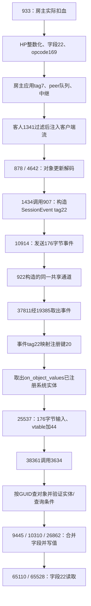

# 对象更新消息到 ECS 字段写入：投递链已静态闭合

目标固定为 **Web 0.126.0 / 3e72472a**，原始WASM SHA-256为 `067059375d884186338e6f86364b658f1daf6bdb779908d6d0c116f2068b147c`。本轮补齐了上一轮明确留下的“解码消息到 `on_object_values` 的事件投递”缺口。

现在能按同一数据流说明：opcode169解码、事件转换、同一通道实例的发送/接收、注册键查询、携带事件调用已注册系统、按GUID选择对象、合并并写入其字段。与[此前的HP封包/合作传输链](2026-11-01-coop-sync.md)组合，已经形成一条从房主实际扣血到客人对象字段更新的完整静态路径。尚未以两台设备运行对局验证送达、显示和时序。

## 完整路径



图中网络段由上一轮的发送与接收实现对应；本轮没有模拟网络送达。对象应用段保留实体存在、代际及查询条件，不表示所有收到的消息都会无条件写入一个现存对象。

## 消息如何变成内部事件

| 表示层 | 原件中的值或布局 | 已追到的操作 |
|---|---|---|
| 线上的原始包 | opcode169，更新块kind0 | 878进入4642；kind0读取GUID和Fields。 |
| 解码消息 | discriminant `0x80000007` | 1434成功分支调用907，按对象更新消息处理。 |
| 解码更新记录 | 内部tag2，记录步长168字节 | 907进入相应分支，保留GUID和字段内容。 |
| `SessionEvent` | 步长176；tag22位于0，GUID位于8，Fields描述符位于16 | 907构造事件；1434逐项交给10914。 |
| 注册表索引 | u16 key20 | 37811由事件tag计算，然后匹配已注册处理器。 |
| HP字段 | Fields中的索引22 | 字段掩码bit22和对应u32值，与事件tag22属于不同结构。 |

这是具体的转换关系，不靠两个结构恰好都含数字22来连接。907还合并临时事件向量并追加tag26的批结束事件；本轮重点证明对象字段值事件的投递。

原件保留的完整类型名为 `bevy_ecs::system::system_registry::RegisteredSystem<bevy_ecs::system::input::In<benilla_protocol::events::SessionEvent>, ()>`。因此接收端是携带 `SessionEvent` 输入运行的已注册系统；投递经过应用自己的注册表和运行回调。本报告没有把它泛称为某个未经核对的Bevy消息API。

## 发送与接收确实属于同一通道

初始化函数922中，同一个构造来源 `local7` 同时进入：

- 网络任务Future的endpoint：`future+0 = flavor1`，`future+4 = local7`。
- 返回给接收侧的endpoint：构造输出 `+8 = flavor1`，`+12 = local7`；随后由临时位置76/80转入536/540，再安装到相应World资源。

1434首次poll将endpoint复制到 `future+32`。之后保存的是**这个endpoint的地址**，沿以下路径保留：

```text
future+32的地址
  → future+288 → future+312的低32位
  → future+864（nested_state = future+344，因此也是nested_state+520）
  → nested_state+552 → local114 → nested_state+892
  → 10914的endpoint参数
```

10914再读取endpoint的 `+4`，得到的共享指针仍来自922的同一 `local7`。这区分了“句柄地址”和“句柄内的共享指针”，没有用相同payload类型替代同实例证明。

接收侧资源的TypeId在922安装和37811读取处均匹配同一对i64字：`-7652179191381602884`、`8322580366045022567`。37811从取到的资源记录 `+8` 读取接收端地址，交给19385；19385解引用接收端句柄再取 `+4` 的共享指针。取出的176字节事件进入同一分发循环。

这些TypeId是该编译版本内部标识，不是线上协议字段或跨版本稳定API。初始化中的其他控制通道没有与这条事件通道混用。

## 注册表、系统调用和字段写入

922用27452将 `on_object_values` 的系统实体与名称加入 **key20**，每个处理器描述符为16字节。注册表资源的TypeId也在注册访问器9713和分发器37811中一致。

37811读取事件tag，按原始运算计算：

```text
key = (tag_u64 <= 1 ? 16 : wrapping_u32(tag_u64) - 2) & 65535
# tag22 → key20
```

它查出key20对应的处理器列表并调用25537。25537查取同类型的 `RegisteredSystem<In<SessionEvent>>` 组件，复制176字节输入，再通过系统vtable的 `+44` 调用。原始数据段和element表严格对应：

```text
on_object_values vtable6033116 +44
  → table slot14258 → function38361 → function3634
  → incoming tag22分支 → 字段合并9445/10310 → 字段setter26862
```

单个/最后一个处理器移交原事件；多处理器分支会深复制两组字段向量，保留GUID、掩码、u32值和尾部u16。深复制后的指针会变化，不能称整个176字节逐位相同。

3634从事件 `+8` 取64位GUID，用同一GUID查询对象映射并取得实体句柄；现存对象路径还检查实体代际、状态、查询边界和成员位。条件成功时，找到该对象的Fields组件并合并收到的内容。目标缺失或过滤失败另有备用记录路径，不能笼统说一定立即写入或一定丢弃。

26862设置对应掩码位并写入 `values[index]`；字段22读取函数明确检查bit22，再从值数组的 `22*4` 位置取u32。这把网络HP字段接到了客户端对象数据的实际写入和读取。

分发器本身也有安装依据：922将vtable5999068及系统对象交给44683构造配置，再经33765/35968/4126应用到World中的配置。该vtable的 `+36/+40/+44` 经原始element表对应78110/62585/62584，三个包装函数都调用37811。本轮没有据此猜测调度标签、执行频率或完整调度器时序。

## 复现与证据

```sh
python3 reverse-engineering/scripts/trace_ecs_forward.py --index /path/to/index.sqlite
python3 reverse-engineering/scripts/trace_ecs_backward.py --index /path/to/index.sqlite
python3 reverse-engineering/scripts/ecs_event_map.py --index /path/to/index.sqlite
```

三条入口均严格绑定原始WASM、完整WAT和代码节函数范围，保留完整函数及其哈希；只检查静态指令，不运行原游戏。根代理独立重跑后，**47处指令guard、5处结构化分支匹配、25项命名网络系统注册**均通过。

本轮另保留33个完整关键函数，并经固定REA 6.8.0的Evidence库校验，提供方为明确标识的 `azeroth-ports-local-wasm-focus`。Evidence：`ev_9e5275a3e7ce53c9c65593e57fcfb2de48b5838e753e74d94a8cab9c0cedbece`。原版REA的大小限制未改，也没有宣称其完整WASM入口已分析整个核心。

机器可读摘要、各次本地提取目录、原件/vtable/函数哈希和独立审查记录见[ecs-delivery.json](2026-11-01-ecs-delivery.json)。完整WAT及原件仍只保存在被忽略的本机研究区。

本轮完成的是该HP/对象字段值路径的静态闭合。真实跨端对局、丢线重连、渲染收敛、全部消息/技能分支和完整源码恢复没有因此自动完成；现有APK、Mac App、游戏核心和存档未修改。
