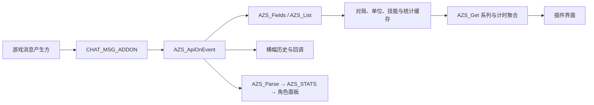

# 内嵌 Lua 源模板提取

日期：2026-11-01（Asia/Taipei）。目标：官方网页核心 **0.126.0 / 3e72472a**，原件 SHA-256 `067059375d884186338e6f86364b658f1daf6bdb779908d6d0c116f2068b147c`。

这是辅助 REA 调查的本地逐字节提取与词法索引。REA 6.8.0 未在这里分析 Lua 语义；原作完整 Lua 仅保存在忽略的本机证据目录，没有加入公开报告。

| 可识别源块 | WASM 文件范围，末尾不含 | 字节 | 命名函数 |
|---|---|---:|---:|
| Addon API 源模板 | `[77755796,77774732)` | 18,936 | 39 |
| 角色统计面板源码 | `[81306394,81314978)` | 8,584 | 11，另有2个匿名函数 |

两块源 SHA-256 分别为 `34cbd3f976e6207783b365e881fcce580b6cd1f6fe886660418bcbbd6d61bb54`、`5ae575eb7b036b413f2eb7a33c93dec1af8488b532fde3acd19b2bcccf1f151e`。API 模板还对应 data segment 3488 的内存范围 `[1758940,1777876)`；code body 3323 的文件偏移 `20720030` 存在匹配的指针／长度常量字节序列。本地辅助解析未独立解码该处完整指令流。

## 恢复的接收与显示链



消息分发器处理22种前缀，包括 `AZSRUN`、`AZSUNITS`、`AZSSPELLS`、`AZSMETER`、`AZSBANNER` 和 `AZS`。JSON 报告保存完整前缀、缓存映射和函数名称清单。消息的产生方及其 Rust 计算不在这两块 Lua 中。

可写动作仅观察到：`AZS_OpenStoredLevels` 设置 `spendLevels=1`；`AZS_SetStoringLevels` 设置 `storeLevels=1/0`；`AZS_SetHudShown` 修改所选 HUD 的 CVar。此外有 UI 置顶名称列表、横幅回调注册和最多20条横幅历史。没有在此源块中找到设置真实伤害、生命、经验或掉落的动作；缓存并不是战斗状态本身。

角色面板从 `AZS_STATS` 读取42个统计字段，将 `dmg-1`、`1-cd` 等转换成显示百分比。`AZS_Parse` 将消息中出现的非数值或空值转为0，未出现的键仍不存在。这些是接收、解析和显示逻辑，不能当成伤害计算规则恢复。

## 复现与边界

```sh
python3 reverse-engineering/scripts/extract_embedded_lua.py
# 可选：用本机已有 LuaJIT 仅编译检查，不执行源码。
python3 reverse-engineering/scripts/extract_embedded_lua.py --compile
```

脚本严格验证90,116,970字节原始 WASM 的完整 SHA-256，以及两处固定边界、长度和分块 SHA-256；每次只写新的 `evidence/<UTC时间>-embedded-lua/`。实测两个源块均通过 LuaJIT `-b` 检查，错误原件输入被拒绝，原件哈希保持不变。

API 块含 `HUD_CVARS_LUA` 占位符，因此恢复的是完整可识别源模板；宿主展开后的 HUD 映射仍需另外追踪。词法索引不是完整 Lua 控制／数据流证明，编译通过也不验证宿主 API 或运行行为。本轮没有执行目标、注入消息、修改游戏数值或接触用户存档。

机器可读摘要：[2026-11-01-embedded-lua.json](2026-11-01-embedded-lua.json)。
