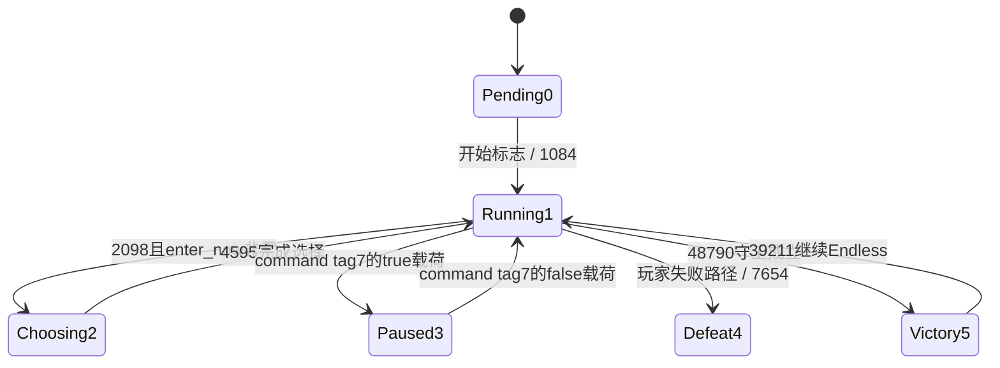

# 主循环、时间步长与运行阶段

目标：当前封装所用官方快照 **0.126.0 / 3e72472a**；原始WASM SHA-256为 `067059375d884186338e6f86364b658f1daf6bdb779908d6d0c116f2068b147c`。本轮恢复的是可用于重造的时钟/阶段主干、暂停与继续、选卡及多人阶段聚合，不是全部菜单、ECS调度或存档初始化。

## 结构视图与时钟

函数880接收 `(tick_context: i32, now: f64)`。上下文 `+0` 的64位标记与 `+8` 的上次时间属于计时包装；下文使用的游戏数据视图 **G = tick_context + 16**。所有2299、2300、2064等偏移均相对G，不能套到其他结构中相同的数字偏移。

第一轮调用的 `dt` 为0；只有旧标记等于1时才计算差值。原指令可还原为：

```text
dt = f32(0)
if context.u64(0) == 1:
    d = now_f64 - context.f64(8)
    if d < 0: d = f64(0)
    if d > f64(0.1): d = f64(0.1)
    dt = f32(d)
context.f64(8) = now_f64
context.u64(0) = 1
```

次序和数值类型需要保留：上/下限比较是ordered比较，NaN差值不会被这段代码归零。正常有限输入每次最多推进0.1个时间单位；后面的游戏时钟使用float32累加。58247/83471两个适配入口先经173617调用JS导入681的 `.now()`，**除以1000**后交880；原件确认该换算，具体浏览器时钟对象及调用频率尚未追完。

包装时间戳在阶段判断前更新，所以暂停期间只要tick仍被调用，就不会把暂停的整段时间在恢复后补进模拟。若tick本身被挂起，恢复时差值仍受0.1上限约束。此处未做实机帧率或后台恢复测试。

## 已确认的阶段值

| G字节2299 | 本轮允许使用的解释 | 直接依据 |
|---:|---|---|
| 0 | 尚未开始/等待开始分支 | 880检查开始标志2287，满足后调用1084。 |
| 1 | 运行 | 880仅在该值推进单状态模拟；1084设置该值。 |
| 2 | 选卡打开 | 2098可进入该值；1065入口要求该值才允许选择。 |
| 3 | 暂停 | 1366进入/离开该值，并生成 `paused` / `unpaused` 通知。 |
| 4 | 失败/结束 | 7654设置该值，结束输出含 `defeat`。 |
| 5 | 胜利 | 48790设置该值并输出 `victory`；39211可继续Endless。 |

这些是解释名，不是恢复出的Rust枚举定义；没有以此声称所有初始化、存档恢复和菜单态都已穷尽。G首字段另有64位值2的可用性守卫，不能把它与阶段字节0/2混为一谈。



复归处理4391也设置运行1、清理408/2264并输出 `revived`；其完整前置调用条件未在本轮穷尽，所以未画成无条件“任意状态→运行”。

## 开始、暂停与选卡主干

在G模式字节2294为0的路径，880对阶段0且开始标志2287最低位非零的状态清除开始标志并调用1084。1084设置阶段1，之后同次tick可进入运行分支。开始标志的完整UI/构造来源及所有初始字段仍需另行恢复。

1366处理的原始命令tag7被转换成其首个分发表的selector4，目标block在11386行结束。载荷字节 `+4` 为零时尝试恢复，为非零时尝试暂停：

```text
if pause_requested:
    if G.phase == 1 and (G.mode2294 & 1) == 0:
        G.phase = 3
        call35322(G)
        emit("paused")
else:
    if G.phase == 3 and (G.mode2294 & 1) == 0:
        G.phase = 1
        call25345(G)
        emit("unpaused")
```

35322与25345不只是改阶段：它们取得40字节移动记录，分别经45603/27317构造包入待发送队列；恢复路径还有 `duration * 1000` 的无符号转换。具体移动/地形插值尚未全部命名，不把这些辅助函数泛化成全局时间缩放。

2098创建选项时，只有 `enter_now` 参数非零才设置阶段2；模式字节2294为0时还调用35322。4595结束选择后设置阶段1，同样仅在模式0时调用25345。因而生成或刷新选项与实际进入选卡阶段不能直接混为一件事。

单状态模式中，阶段3或2不会进入880的运行时钟/主模拟分支，但该函数后面的通知、客户端和网络队列处理仍位于这个分支之外。不能把“模拟暂停”解释为浏览器、网络或全部UI停止运行。

## 多角色分支有两层阶段

2294非零路径使用全局阶段 **2300**，不是只看个人阶段2299。全局阶段为0、开始标志满足且额外2295守卫通过时，1084设置全局阶段1；全局阶段1时推进G时钟2064。

该分支遍历1808字节角色记录，并通过1678交换当前角色的数据。其中阶段执行精确交换：`G.u8(2299) ↔ player_record.u8(1800)`。已经恢复的交换表不包含全局时钟2064；全局时钟不是每换一个玩家就重置一遍。具体模式枚举名称没有从Rust定义恢复，不将其数值与外层合作角色枚举2320直接等同。

主循环汇总本次角色阶段后，结局规则为：

```text
if any(player_phase in {1, 2}):
    不做该次全局结局转换
else:
    global_phase2300 = 5 if any(player_phase == 5) else 4
```

因此某个角色选卡2并不意味着整个多角色会话的时钟暂停；该角色的部分更新仍有个人阶段1守卫。没有观察到暂停命令绕过模式守卫的分支。空汇总在这个代码块中会选4；是否允许空会话走到这里仍由上游状态约束。

## 胜利、无尽与顺序接口

48790要求G字段400非零、阶段1且2280最低位未置位，随后设阶段5并生成 `victory`。字段400的全部生命周期仍属世界/胜负规则研究，不能单凭这个检查替它恢复一个完整Rust字段名。

39211仅在阶段5时恢复运行1、将2280置1，并设置 `2172 = clock2064 + f32(300)`，同时包含 `Endless` / `The onslaught never ends...` 文本。这是胜利后无尽继续路径，**阶段5不是暂停状态**。

单状态运行尾部观察到以下调用顺序；948和2365位于 `G.u8(2291)==0` 的共同条件内，其余列出的调用在此阶段尾部按顺序进入（其函数内部仍可能再检查条件）：

```text
2896 → 917 → 976 → 1819 → 3849 → 915 → 37799 → 1874
→ 921 → 2852 → 2563 → 948 → 2365 → 48790
```

917技能/冷却、948生成、2852拾取等业务细节由对应规格继续恢复。本页仅固定原始顺序和阶段边界，不靠数字编号猜其他函数的用途。

## 复现与范围

```sh
python3 reverse-engineering/scripts/trace_game_loop.py --index /path/to/index.sqlite
```

脚本实跑保留19个完整函数，25处指令guard、11处结构化分支匹配、8个原件阶段字串均通过；提取目录为 `evidence/game-loop-20261031T224735.578795Z/`。原始模块/完整WAT在前后均验证身份，代码节范围与每个函数哈希绑定。

同19个完整函数另经明确标识的本地REA扩展保留并验证Evidence：`ev_e90420d4923e8956b73108ce4545977c21c8c0c03a17b8360465411065e86ca3`，提供方 `azeroth-ports-local-wasm-focus`，本地目录 `evidence/wasm-focused-20261031T224507.473672Z/`。这不表示原版REA的8MiB入口已能接受90MB核心。

另一条研究线独立复核了主循环dt夹取/NaN边界、单状态phase1时钟门控，以及tag7暂停/恢复的结构化跳转与模式守卫。当前机器可读摘要保存实际运行目录、guards与哈希：[game-loop.json](2026-11-01-game-loop.json)。

尚未穷尽菜单/构造/存档状态、全部命令、完整ECS调度、所有个人计时器及多角色的全部边界。该规格没有执行原游戏、连接官方服务、修改安装包或存档。
